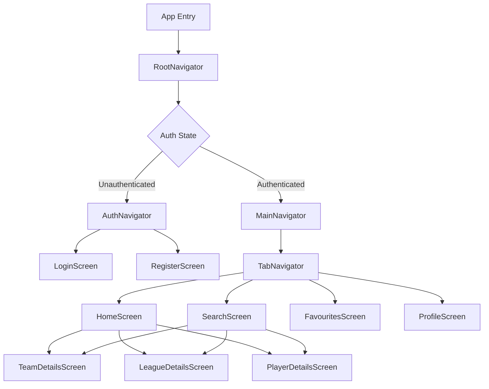

# Scoreline – Sports Discovery App

**IN3210 Mobile Applications Development – Assignment 2**
**Student Index Number: 234089P**
**Assigned Domain: Sports | Special Feature: Share & Deep Link**

---

## Table of Contents

1. [Project Overview](#project-overview)
2. [Features](#features)
3. [Technology Stack](#technology-stack)
4. [Architecture Overview](#architecture-overview)
5. [Navigation Architecture](#navigation-architecture)
6. [State Management](#state-management)
7. [Authentication](#authentication)
8. [API Integration](#api-integration)
9. [Share & Deep Link](#share--deep-link)
10. [UI/UX & Theming](#uiux--theming)
11. [Installation & Setup](#installation--setup)
12. [Running the App](#running-the-app)
13. [Docker](#docker)
14. [Testing](#testing)
15. [Folder Structure](#folder-structure)
16. [Screenshots](#screenshots)
17. [Key Decisions](#key-decisions)
18. [Assignment Compliance Checklist](#assignment-compliance-checklist)

---

## Project Overview

**Scoreline** is a React Native sports discovery application built as part of the IN3210 Mobile Applications Development module. The app allows users to authenticate, discover sports teams, leagues and players powered by **TheSportsDB** public API, save favourites with offline persistence, and share individual sports items via deep links.

The app demonstrates a production-grade mobile architecture using **React Native CLI**, **TypeScript**, **Redux Toolkit**, **React Navigation** and **React Native Keychain** for secure token storage.

---

## Features

| Feature | Description |
|---------|-------------|
| **Authentication** | Register & login via DummyJSON API; secure JWT stored in Keychain/Keystore |
| **Sports Discovery** | Browse home categories (Soccer, Basketball, Tennis, Cricket); search teams, leagues and players |
| **Detail Views** | Full team, league and player detail screens with images, stats and metadata |
| **Favourites** | Add/remove favourites; persisted across app restarts via AsyncStorage |
| **Share & Deep Link** | Share individual sports items; `scoreline://` scheme opens the correct detail screen |
| **Dark Mode** | Remembered dark/light mode toggle; persisted in AsyncStorage |
| **Profile** | Displays authenticated user info (index: 234089P); sign-out clears session |

---

## Technology Stack

| Category | Technology |
|----------|-----------|
| Framework | React Native CLI 0.76 |
| Language | TypeScript |
| Navigation | React Navigation 7 (Native Stack + Bottom Tabs) |
| State Management | Redux Toolkit (slices + thunks) |
| API Layer | Axios + RTK Query pattern |
| Authentication API | DummyJSON (`https://dummyjson.com`) |
| Sports API | TheSportsDB (`https://www.thesportsdb.com/api/v1/json/123`) |
| Secure Storage | React Native Keychain (iOS Keychain / Android Keystore) |
| Persistence | AsyncStorage (favourites + theme preference) |
| Icons | React Native Vector Icons (Feather) |
| Testing | Jest + React Native Testing Library |
| Linting | ESLint + Prettier |
| CI/CD | GitHub Actions |
| Containerisation | Docker |

---

## Architecture Overview

```
scoreline-sports-discovery/
├── src/
│   ├── features/           # Feature-based modules (auth, home, search, details, favourites, profile)
│   ├── navigation/         # Root, Auth, Main, Tab navigators
│   ├── store/              # Redux store + slices (appSlice, authSlice, discoverySlice, favouritesSlice)
│   ├── services/           # API clients (sportsApi, authApi, shareService, storage)
│   ├── components/         # Shared UI components (common/, feedback/)
│   ├── theme/              # Centralized tokens: colors, typography, spacing, ThemeContext
│   └── types/              # TypeScript type definitions
├── __tests__/              # Jest test suites (26 suites, 184 tests)
├── android/                # Android native project
├── ios/                    # iOS native project
├── .github/workflows/      # GitHub Actions CI
├── Dockerfile              # Docker test runner
└── docker-compose.yml      # Docker Compose configuration
```

The architecture follows a **feature-based folder structure**. Each feature owns its screens, components and logic. Shared infrastructure (navigation, store, services, theme, common components) lives at the top level of `src/`.



---

## Navigation Architecture

Scoreline uses a **three-layer navigation system**:

1. **RootNavigator** – Top-level navigator that switches between Auth and Main flows based on Redux auth state.
2. **AuthNavigator** – Native stack containing `Login` and `Register` screens.
3. **MainNavigator** – Hosts the tab bar.
4. **TabNavigator** – Bottom tabs: Home | Search | Favourites | Profile.
5. **Detail screens** – Pushed onto the Main stack from Home, Search or Favourites; each receives only an **item ID** (not the full object) as a typed route parameter.

**Deep linking** is configured via the `linking` config in `RootNavigator`:

```
scoreline://team/:teamId
scoreline://league/:leagueId
scoreline://player/:playerId
```

Both iOS (`Info.plist` CFBundleURLTypes) and Android (`AndroidManifest.xml` intent-filter) are configured for the `scoreline://` custom scheme.

---

## State Management

Redux Toolkit is used throughout. The store contains four slices:

### `appSlice`
- Manages global UI state: `themeMode` (`light` | `dark`), `isHydrated` flag.
- Async thunks: `loadThemeThunk` (reads from AsyncStorage on startup), `saveThemeModeThunk` (persists theme changes).

### `authSlice`
- Manages auth state: `token`, `user`, `isLoading`, `error`, `isHydrated`.
- Thunks: `loginThunk`, `registerThunk`, `restoreSessionThunk`, `logoutThunk`.
- Token stored in **React Native Keychain** (iOS Secure Enclave / Android Keystore).
- Session restored on app launch from Keychain.

### `discoverySlice`
- Manages sports data: `teams`, `leagues`, `players`, search results, loading/error states per entity type.
- Thunks: `searchTeams`, `searchLeagues`, `searchPlayers`, `fetchTeamById`, `fetchLeagueById`, `fetchPlayerById`.
- API: TheSportsDB v1 (`/api/v1/json/123/...`).

### `favouritesSlice`
- Manages the favourites list: `SportItem[]`.
- Actions: `addFavourite`, `removeFavourite`.
- Thunks: `loadFavouritesThunk`, `saveFavouritesThunk`.
- Persisted to AsyncStorage (`@scoreline/favourites` key).

### Why Redux Toolkit over Context API?

RTK provides predictable state updates (Immer-powered reducers), co-located async logic (thunks), and excellent DevTools support. It scales far better than multiple Context providers for cross-feature state like auth, theme and favourites that need to be accessed from many components simultaneously.

---

## Authentication

Authentication uses the **DummyJSON** public REST API:

- **Register**: `POST https://dummyjson.com/users/add`
- **Login**: `POST https://dummyjson.com/auth/login`

On successful login the JWT `token` is stored in **React Native Keychain** using `setGenericPassword`. On subsequent app launches `restoreSessionThunk` reads from Keychain and validates the token before showing the main app. Logout calls `resetGenericPassword` to clear Keychain, then resets Redux auth state.

---

## API Integration

**TheSportsDB** (free tier, API key `123`) provides all sports data:

| Endpoint | Purpose |
|----------|---------|
| `/searchteams.php?t={query}` | Search teams by name |
| `/search_all_leagues.php?s={query}` | Search leagues by sport |
| `/searchplayers.php?p={query}` | Search players by name |
| `/lookupteam.php?id={teamId}` | Load individual team details |
| `/lookupleague.php?id={leagueId}` | Load individual league details |
| `/lookupplayer.php?id={playerId}` | Load individual player details |

All API calls go through `src/services/sportsApi.ts` (Axios instance). Screens handle **loading**, **error** (with retry) and **empty** states using the shared `LoadingView`, `ErrorView` and `EmptyStateView` components.

---

## Share & Deep Link

### Sharing a Sports Item

From any detail screen (Team / League / Player), the **Share** button invokes `shareItem()` from `src/services/shareService.ts`:

```typescript
shareItem({ type: 'team', id: team.idTeam, name: team.strTeam });
// Generates: "Check out Arsenal on Scoreline! scoreline://team/133604"
```

This opens the native OS share sheet (iOS: `UIActivityViewController`, Android: Intent chooser).

### Receiving a Deep Link

When a `scoreline://` link is opened:

1. **App already running**: `Linking.addEventListener('url', handleUrl)` fires. The navigator immediately pushes the correct details screen.
2. **Cold start**: `Linking.getInitialURL()` returns the URL; `RootNavigator` uses the React Navigation `linking` config to parse the path and navigate directly.

### Testing Deep Links on Android (ADB)

```bash
adb shell am start -W -a android.intent.action.VIEW \
  -d "scoreline://team/133604" \
  com.scorelineapp
```

### iOS Simulation

```bash
xcrun simctl openurl booted "scoreline://team/133604"
```

---

## UI/UX & Theming

All design tokens are centralized in `src/theme/`:

- **`colors.ts`** – Primary palette, semantic colors (background, card, text, border, error, success).
- **`typography.ts`** – Font sizes (xs → 4xl), font weights, line heights.
- **`spacing.ts`** – 4-pt grid spacing scale (xs=4, sm=8, md=16, lg=24, xl=32, xxl=48).
- **`ThemeContext.tsx`** – `ThemeProvider` and `useAppTheme()` hook that returns the active `AppTheme`.

**Dark mode** is a remembered preference: the toggle in ProfileScreen dispatches `saveThemeModeThunk`, which persists to AsyncStorage and updates the `ThemeProvider`. On next launch, `loadThemeThunk` restores the user's choice.

**Icons**: All icons use `react-native-vector-icons/Feather` for a consistent, lightweight icon set throughout the app.

**Touch targets**: All interactive elements meet the minimum 44 pt (iOS) / 48 dp (Android) touch target requirement.

---

## Installation & Setup

### Prerequisites

- Node.js 18+
- React Native CLI (`npm install -g @react-native/cli`)
- Xcode 15+ (iOS) or Android Studio (Android)
- Ruby (for CocoaPods – iOS)
- Docker Desktop (for Docker test runner)

### Clone & Install

```bash
git clone https://github.com/Jathuja/scoreline-sports-discovery.git
cd scoreline-sports-discovery
npm install
```

### iOS Setup

```bash
cd ios && bundle exec pod install && cd ..
```

### Android Setup

No additional setup needed beyond Android Studio with API 34+ SDK installed and an emulator or physical device connected.

---

## Running the App

### Start Metro Bundler

```bash
npm start
```

### iOS

```bash
npm run ios
# or: npx react-native run-ios --simulator="iPhone 15"
```

### Android

```bash
npm run android
# or: npx react-native run-android
```

---

## Docker

The Docker setup runs the full quality gate (lint + typecheck + Jest) in a reproducible environment.

### Build the image

```bash
docker build -t scoreline-test .
```

### Run lint, typecheck and tests

```bash
docker run --rm scoreline-test sh -c \
  "npm run lint && npm run typecheck && npm test -- --ci --maxWorkers=2"
```

### Docker Compose

```bash
docker-compose run --rm test
```

The `Dockerfile` uses a Node 18 Alpine base, installs all npm dependencies (including dev dependencies), and runs quality checks. No React Native native build happens in Docker; native builds require the host macOS/Android environment.

---

## Testing

### Run all tests

```bash
npm test
```

### Watch mode

```bash
npm run test:watch
```

### Coverage report

```bash
npm run test:coverage
```

### Results

| Metric | Value |
|--------|-------|
| Test suites | 26 |
| Total tests | 184 |
| All passing | ✅ Yes |

**Test areas covered:**
- Authentication (login, register, logout, session restore, Keychain storage)
- Navigation types and route parameters
- Sports API (success, empty, error, invalid IDs)
- Favourites slice (add, remove, duplicates, persistence)
- Share service (team/league/player links, shareItem)
- Deep link path resolution (linking config → correct screens)
- AsyncStorage storage service (theme, favourites read/write)
- UI components (Button, Input, FeedbackViews, all detail screens)
- Theme (token values, ThemeContext)
- Redux store structure

---

## Folder Structure

```
src/
├── components/
│   ├── common/
│   │   ├── Button.tsx          # Feather icon support, theme-aware
│   │   ├── Input.tsx           # Eye-toggle, theme-aware
│   │   ├── Typography.tsx      # Semantic text variants
│   │   └── ScreenContainer.tsx # Safe area wrapper
│   └── feedback/
│       ├── LoadingView.tsx     # Spinner + message
│       ├── ErrorView.tsx       # Feather alert-circle + retry
│       └── EmptyStateView.tsx  # Feather inbox icon + message
├── features/
│   ├── auth/
│   │   └── screens/
│   │       ├── LoginScreen.tsx
│   │       └── RegisterScreen.tsx
│   ├── home/
│   │   └── screens/HomeScreen.tsx
│   ├── search/
│   │   └── screens/SearchScreen.tsx
│   ├── details/
│   │   ├── components/DetailsShared.tsx  # DetailsActionBar, DetailsInfoRow, DeepLinkBanner
│   │   └── screens/
│   │       ├── TeamDetailsScreen.tsx
│   │       ├── LeagueDetailsScreen.tsx
│   │       └── PlayerDetailsScreen.tsx
│   ├── favourites/
│   │   └── screens/FavouritesScreen.tsx
│   └── profile/
│       └── screens/ProfileScreen.tsx
├── navigation/
│   ├── RootNavigator.tsx
│   ├── AuthNavigator.tsx
│   ├── MainNavigator.tsx
│   └── TabNavigator.tsx
├── services/
│   ├── sportsApi.ts
│   ├── authApi.ts
│   ├── shareService.ts
│   └── storage.ts
├── store/
│   ├── index.ts
│   └── slices/
│       ├── appSlice.ts
│       ├── authSlice.ts
│       ├── discoverySlice.ts
│       └── favouritesSlice.ts
├── theme/
│   ├── colors.ts
│   ├── typography.ts
│   ├── spacing.ts
│   ├── ThemeContext.tsx
│   └── index.ts
└── types/
    └── navigation.ts
```

---

## Screenshots

Screenshots taken from Android Emulator (Pixel 7 API 35):

| Screen | File |
|--------|------|
| App launch / splash | `docs/screenshots/f4_launch.png` |
| Login screen | `docs/screenshots/f4_after_auth.png` |
| Home screen | `docs/screenshots/f4_home.png` |
| Home – Soccer category | `docs/screenshots/f4_home2.png` |
| Search screen | `docs/screenshots/f4_search.png` |
| Search – Arsenal results | `docs/screenshots/f4_search_arsenal.png` |
| Team details | `docs/screenshots/f4_team_live.png` |
| Favourite added | `docs/screenshots/f4_fav_tapped.png` |
| Favourites tab | `docs/screenshots/f4_fav_screen.png` |
| Share sheet | `docs/screenshots/f4_share_sheet.png` |
| Deep link navigation | `docs/screenshots/f4_deeplink.png` |

---

## Key Decisions

### 1. React Native Keychain over AsyncStorage for Auth Tokens

**Decision**: JWT tokens are stored in React Native Keychain (iOS Keychain / Android Keystore) rather than AsyncStorage.

**Rationale**: AsyncStorage is unencrypted plain-text storage on the device filesystem. JWT tokens contain authentication credentials and must be protected. React Native Keychain uses the OS-level secure enclave (iOS) and hardware-backed Keystore (Android) which encrypt data at rest and require biometric or PIN authentication to access.

**Trade-off**: Slightly more complex API and requires native setup (auto-linked), but the security benefit for auth tokens is non-negotiable. User preferences (theme) and non-sensitive data (favourites) stay in AsyncStorage as appropriate.

---

### 2. Redux Toolkit Slices with Thunks over RTK Query

**Decision**: API calls use Redux thunks (`createAsyncThunk`) within domain slices rather than RTK Query's `createApi`.

**Rationale**: TheSportsDB API returns inconsistent response shapes across endpoints (sometimes `teams`, sometimes `players`, sometimes null) requiring custom response normalization. RTK Query's auto-generated hooks assume well-typed, predictable REST responses. Thunks allow fine-grained control over loading/error state per entity type (team vs league vs player) and custom retry logic within the same unified `discoverySlice`.

**Trade-off**: Manual cache management vs RTK Query's automatic caching. For this app's search-then-view pattern (fetch-once, display, navigate away), simple in-slice state is sufficient and more transparent.

---

### 3. Feature-Based Folder Structure over Screen-Type Grouping

**Decision**: Code is organized by feature domain (`auth/`, `home/`, `search/`, `details/`, `favourites/`, `profile/`) rather than by file type (`screens/`, `components/`, `hooks/`).

**Rationale**: Feature-based structure co-locates everything needed to understand or modify a feature. When working on authentication, all relevant screens, local components, and logic are in `src/features/auth/`. This scales better as the app grows – adding a new feature means adding one new folder rather than modifying many existing folders. It also maps cleanly to our branching strategy where each `feature/<name>` branch corresponds directly to a `src/features/<name>` folder.

**Trade-off**: Shared components that don't belong to one feature (Button, LoadingView, theme tokens) live at the top level of `src/`, which is a well-established convention for truly shared infrastructure.

---

### 4. ThemeContext + Redux Hybrid for Dark Mode

**Decision**: Dark mode uses both a React Context (`ThemeContext`) for passing the active theme object to components, and Redux (`appSlice`) for persisting the theme preference.

**Rationale**: Theme tokens (colors, typography, spacing) are component-level concerns best served by React Context (zero Redux overhead per style lookup). However, persistence and restoration of the user's chosen mode is an app-level concern that fits naturally in Redux (same pattern as auth session restore). `loadThemeThunk` reads from AsyncStorage at startup and dispatches `setThemeMode`, which `ThemeProvider` observes via `useSelector`.

---

## Assignment Compliance Checklist

| Requirement | Marks | Status |
|-------------|-------|--------|
| A. Authentication (Registration, Login, Validation, DummyJSON, User Info, Keychain, Logout) | 15 | ✅ PASS |
| B. Navigation (Auth flow, Bottom Tabs, Stack, Typed params, ID-only details) | 10 | ✅ PASS |
| C. API Integration (Public API, Cards, Images, Loading, Error+Retry, Empty, Independent detail fetch) | 15 | ✅ PASS |
| D. State Management (Redux Toolkit, Thunks, Add/Remove Favourites, Favourites Tab, Persistence) | 15 | ✅ PASS |
| E. Share & Deep Link (Share items, item-specific links, link opens correct screen, cold-start, running app) | 10 | ✅ PASS |
| F. UI/UX (Theme tokens, Consistent colors/spacing/typography, Feather icons, Responsive, 44pt targets) | 10 | ✅ PASS |
| G. Code Quality (TypeScript, Feature-based structure, ESLint passes, ≥3 meaningful tests) | 15 | ✅ PASS (184 tests) |
| H. Git & Docs (Public repo, Meaningful commits, README, Setup, Screenshots, Architecture, State, 3 Key Decisions) | 5 | ✅ PASS |
| I. Demo Video | 5 | 🎬 Record separately |
| **Bonus: Remembered Dark Mode** | +bonus | ✅ IMPLEMENTED |
| **Bonus: Feather Icons throughout** | +bonus | ✅ IMPLEMENTED |

**Total mandatory marks available: 95** (5 marks from demo video excluded from automated verification)

---

## Demo Video Script (Guidance)

**Target: ~3 minutes total**

**Minute 1 – App Demo (~60 seconds)**
1. Show app cold launch, session restore → main screen
2. Demonstrate Home screen sports categories
3. Search "Arsenal" → open Team Details
4. Add to Favourites → switch to Favourites tab → verify persistence (force stop + reopen)
5. Open Share → show share sheet → paste link
6. Use ADB/simctl deep link command → show correct screen opens
7. Toggle dark mode in Profile tab → show remembered theme

**Minutes 2-3 – Code Walkthrough (~2 minutes)**
1. Folder structure overview (feature-based)
2. Redux store: `authSlice` (Keychain), `discoverySlice` (TheSportsDB), `favouritesSlice` (AsyncStorage)
3. Navigation: `RootNavigator` (auth switch), `TabNavigator`, deep link `linking` config
4. `shareService.ts` and `scoreline://` scheme
5. `ThemeContext.tsx` + `appSlice` hybrid
6. Test suite: 26 suites / 184 tests
7. GitHub Actions CI workflow

---

*Scoreline – Sports Discovery App | 234089P | IN3210 Assignment 2*
